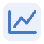

# Tropy Analytics

Charts and connection graphs for your Tropy project. Filter by date, list, tags and metadata. All processing stays on your computer.

## Install

In **Tropy → Preferences → Plugins**, install the release ZIP and enable **Analytics**. Open a project and click the chart icon beside the search field.

## Features

- Year-by-year source frequency chart with clickable bars.
- Dual year range control to focus the whole dashboard on a period.
- People analytics for both Tropy `creator` and `audience` fields, with configurable additional people fields.
- Co-occurrence network connecting creators, audiences, and other names recorded together; node size reflects distinct source count and edge width reflects shared records.
- Drag network nodes to arrange people and inspect their links, or use **Untangle graph** to separate groups automatically; positions are remembered in the project.
- Use the network's inline options to normalize all node sizes or all connection widths.
- Distribution charts for source types and places when those metadata fields exist, plus native folder/collection counts.
- Click a person in the ranking or network to filter the Tropy records that mention that name.
- Filters for nested folders, required or excluded tags, search, inclusive date range, and additional include/exclude metadata conditions.
- Charts and filters update when the open Tropy project changes.
- All analysis runs locally against the current project's in-memory state. No data is transmitted.
- English, Italian, French and Spanish. Light and dark themes.

Names in a metadata field are split on semicolons, vertical bars, line breaks, and spaced slashes. Use semicolons to separate multiple names when possible. The graph connects creator to audience on the same source, as well as names co-occurring on a source; it does not infer a relationship beyond metadata presence.

## Use

- Associate your metadata fields in the sidebar.
- Click a tag to include it, again to exclude it, and once more to clear it.
- Click a person to filter; use mouse back/forward or Alt+Left/Right to navigate.
- Drag graph nodes or use **Untangle graph**. Circle area reflects source count; line thickness reflects shared sources.
- **Open in Tropy** transfers supported filters. Its tooltip identifies limitations.

## Build

Node.js 18+: `npm ci`, then `npm run build`.

License: AGPL-3.0-or-later. See [LICENSE](LICENSE).
